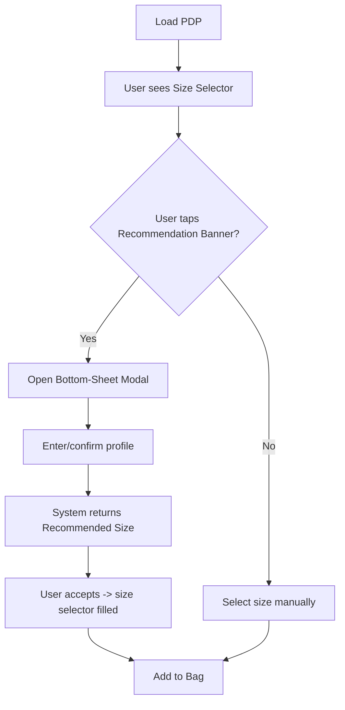

# Screen 1 – Product Page

**Purpose**: Show the mobile product detail page (PDP) where the shopper selects a size and sees a contextual size‑recommendation prompt.

### Layout (375 px viewport)
1. **Header Bar** – Back arrow, brand logo, product name (Roboto 700 16 px).
2. **Product Image Carousel** – 200 px tall placeholder image.
3. **Price & Discount** – Bold price, secondary discount label.
4. **Size Selector** – Horizontal scroll of size chips (XS‑XXXL+). The currently selected size is highlighted with the primary colour.
5. **Recommendation Banner** – Full‑width banner (48 px) with background `#FF3F6C`, white text:
   > "Not sure about your size? Get a recommendation"
   – Tappable area opens the bottom‑sheet modal.
6. **Add to Bag CTA** – Primary button, full width, 48 px high.

### Interaction Flow (Mermaid diagram)

### Assets
- Placeholder product image (use a generic dress silhouette).
- Size chips use the primary colour for the active state and neutral grey for inactive.
- The banner includes a right‑arrow icon indicating navigation.

---
*Prepared by Antigravity agent (UX designer).*