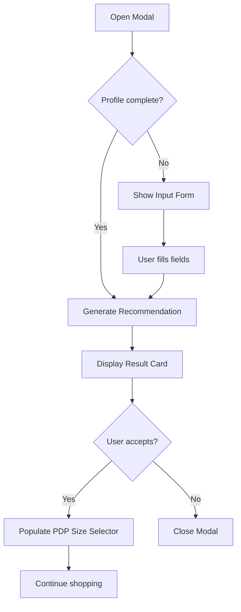

# Screen 2 – Size Recommendation Modal

**Purpose**: Provide a bottom‑sheet modal that collects (or confirms) user profile data and displays the size recommendation with confidence.

### Layout (mobile – max 70% viewport height)
1. **Modal Header** – Drag handle bar, title: *"Find Your Perfect Size"* (Roboto 500 16 px), close (X) icon top‑right.
2. **Profile Inputs** (if missing):
   - **Height** – numeric input (cm) with unit label.
   - **Weight** – numeric input (kg).
   - **Body Type** – radio button group (Hourglass, Athletic, Pear, Apple, Petite, Full‑Bust, Straight). Each option shows a simple silhouette icon.
3. **Generate Button** – Primary CTA *"Get Recommendation"* (disabled until all fields filled).
4. **Result Card** (appears after generation):
   - **Recommended Size** – large bold text (e.g., **M**), coloured `#FF3F6C`.
   - **Confidence** – percentage badge (e.g., *"82% of similar users fit"*), with a small info tooltip.
   - **Explanation** – "Based on 48 rentals with similar height, weight and body type."
   - **Actions** – *"Use Recommended Size"* (primary) and *"Edit Profile"* (secondary link).
5. **Footer** – small note: *"Data powered by Rent‑the‑Runway fit‑feedback dataset (CC‑BY‑4.0)."*

### Interaction Flow (Mermaid)

### Visual Details
- **Background**: `#FFFFFF` with rounded top corners (12 px).
- **Primary colour** (`#FF3F6C`) used for the recommended size badge and CTA.
- **Typography**: body text 14 px, labels 12 px, result size 24 px bold.
- **Iconography**: material info icon next to confidence badge.

---
*Prepared by Antigravity agent (UX designer).*