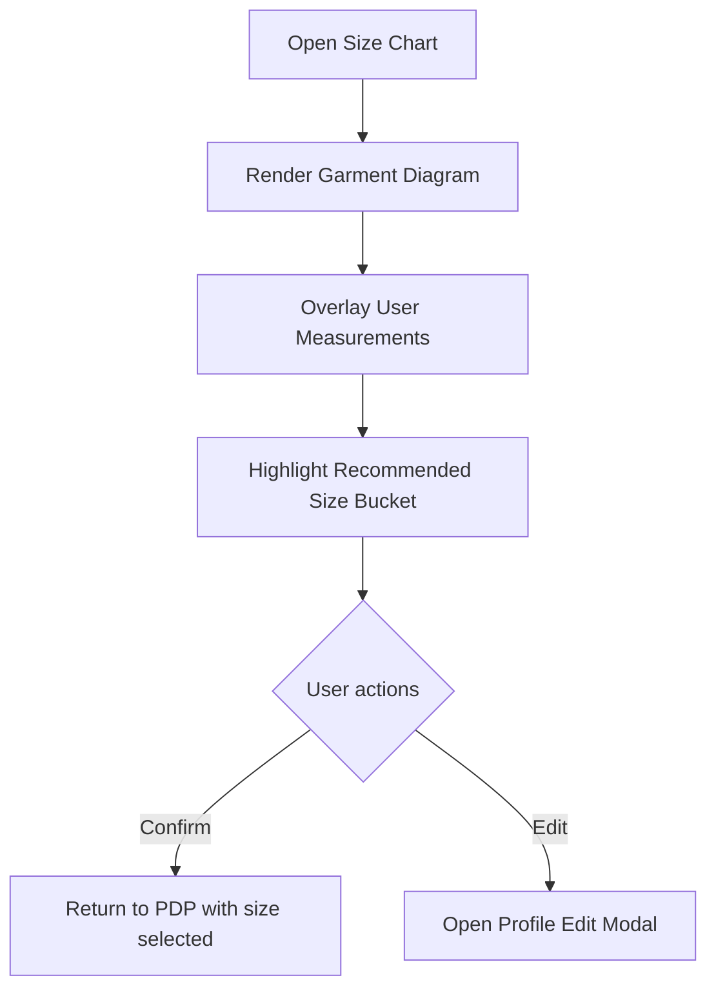

# Screen 3 – Size Chart

**Purpose**: Offer a detailed size‑measurement comparison so the shopper can visually verify how the recommended size aligns with their body dimensions.

### Layout (mobile – full‑screen modal or expandable panel)
1. **Header** – Title *"Size & Measurement Chart"* with back arrow.
2. **Garment Diagram** – Simplified outline of the apparel piece (e.g., dress) with annotated measurement lines (Bust, Waist, Hip, Length).
3. **User Measurements** – Horizontal bars beside each garment dimension showing the user’s value (from profile) in **cm**. Bars are coloured `#FF3F6C` when the user measurement falls within the garment’s size tolerance, otherwise grey.
4. **Size Buckets** – A small legend beneath the diagram listing the measurement ranges for each size bucket (XS‑XXXL+). Highlight the bucket that matches the recommendation.
5. **CTA** – *"Confirm Size"* button (primary) and *"Adjust Profile"* link.
6. **Footnote** – Data source disclaimer.

### Interaction Flow (Mermaid)

### Visual Guidelines
- **Colour Usage**: Primary colour (`#FF3F6C`) for matching bars, neutral grey (`#CCCCCC`) for out‑of‑range.
- **Typography**: Labels 12 px, values 14 px bold.
- **Icons**: Simple ruler/measurement icons (material design).
- **Spacing**: 8 px vertical gutters between each measurement row.
- **Responsive**: Still readable at 320 px width (minimum mobile).

---
*Prepared by Antigravity agent (UX designer).*